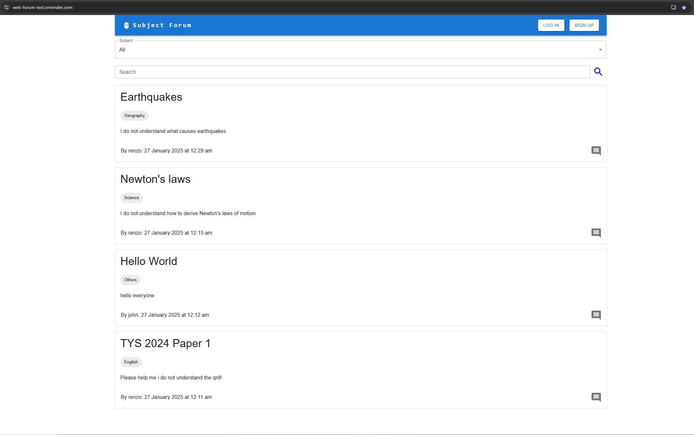
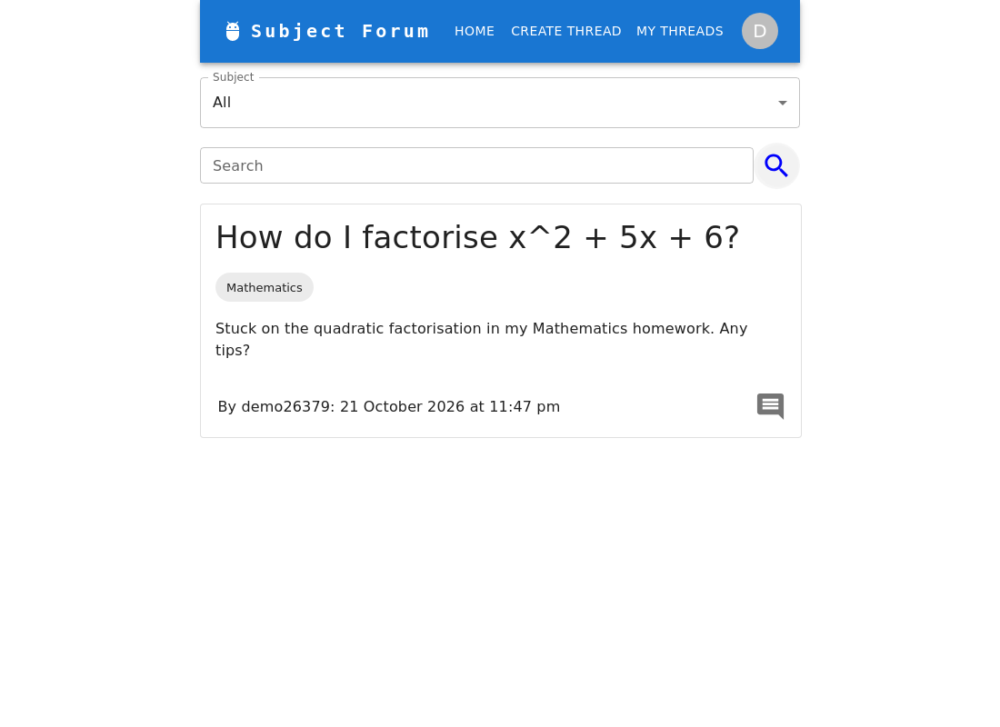
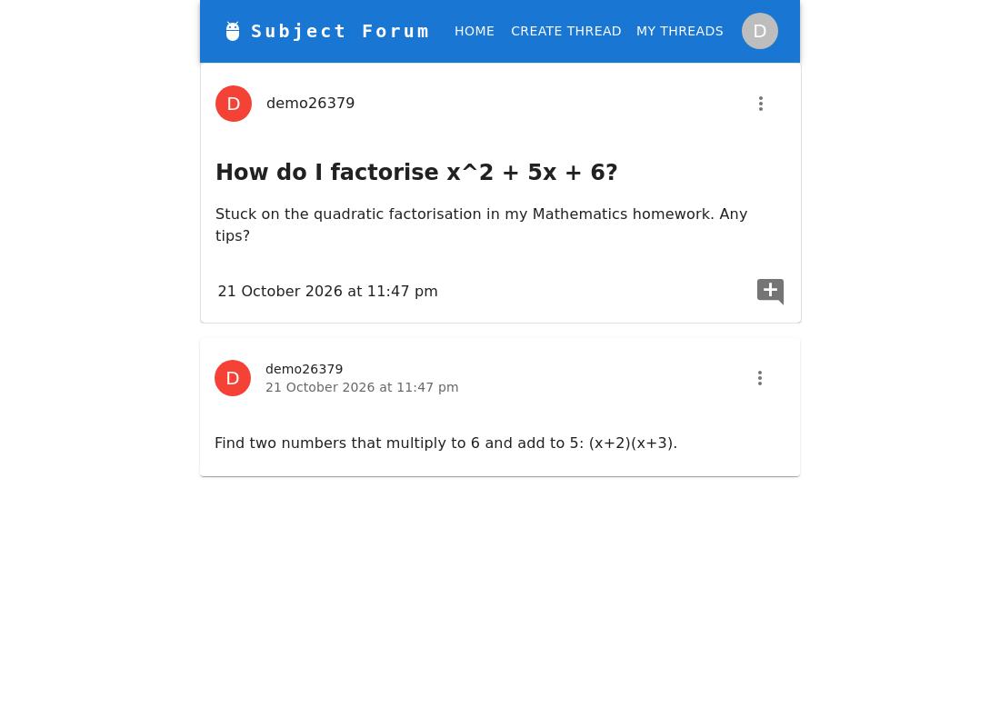
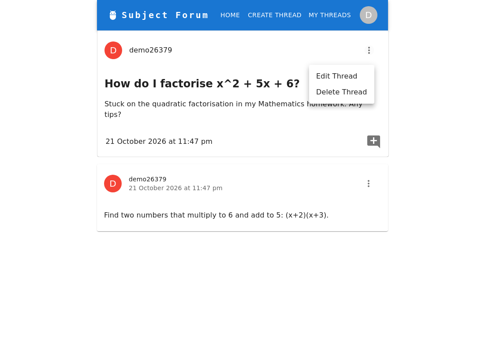
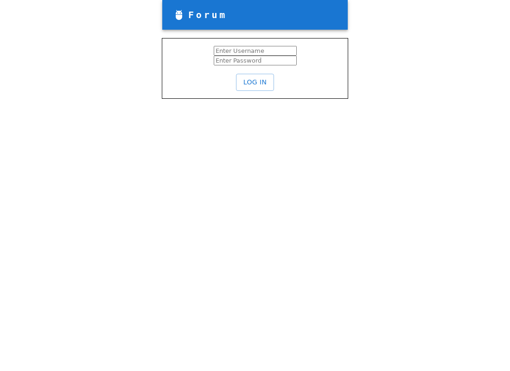

# Subject Forum

A web forum where students post threads and comments under school subjects, built with a React + TypeScript client and a Go (chi) + PostgreSQL API with JWT authentication.



> **The hosted demo is offline** (its free Render database expired on 24-Feb-2025). Run it locally with the steps below, or see the [screenshots](#screenshots).

Built by Chua Renzo for the NUS CVWO Winter Assignment AY24-25.

## Run locally

Prerequisites: Docker (with Compose), Go 1.23.4+, Node.js and Yarn 1.x.

```sh
# 1. Postgres (creates the schema and subject list on first start)  [UNVERIFIED: see Known limitations]
docker compose up -d

# 2. API on http://localhost:8080  (loads server/.env.example; run from the repo root)
cd server && set -a && . ./.env.example && set +a && go run .

# 3. Client on http://localhost:3000  (new terminal, from the repo root)
cd client && yarn install && yarn build && yarn start
```

No source edits are needed. Open http://localhost:3000, sign up, and create a thread.

- If port 3000 is already taken, `yarn start` silently picks another port (it prints it). Start the server with `CORS_ORIGINS=http://localhost:<that port>` or the browser will block API calls.
- Configuration is by environment variable: see [`server/.env.example`](./server/.env.example) (`DATABASE_URL`, `JWT_SECRET`, `PORT`, `CORS_ORIGINS`) and [`client/.env.example`](./client/.env.example) (`REACT_APP_API_URL`, read at `yarn build` time). `JWT_SECRET` is required; the server refuses to start without it. The value in `.env.example` is a local-development placeholder.
- Without Docker: create a database, then `psql "$DATABASE_URL" -f server/schema.sql`.

### Tests

```sh
cd server && go test ./...                 # JWT, auth middleware, signup validation
cd client && CI=true yarn test --watchAll=false   # search-term escaping
bash server/smoke-test.sh                  # needs the server running: curl checks of every route, incl. non-owner 403s
```

The tests are small. There are no automated tests of the database-backed handlers; `smoke-test.sh` is the end-to-end check for those.

## Screenshots

| Thread list, search and subject filter | Thread with a comment |
|---|---|
|  |  |

| Owner-only menu (edit/delete) | Login |
|---|---|
|  |  |

## Features

- Anyone can read threads and comments; posting requires an account.
- Create, edit and delete your own threads and comments. The three-dot menu only appears on your own posts.
- Threads belong to a subject; filter the list with the Subjects dropdown.
- Search matches whole words in the title or body, ignores repeated spaces, and treats punctuation literally (`(`, `c++` are safe to search).
- "My Threads" lists your own threads.
- Change password (re-checks the old one and issues a fresh token).

## Authentication and authorization

1. **Sign up / log in** (`POST /user/signup`, `POST /user/login`): passwords are hashed with bcrypt (default cost) and only the hash is stored. On success the server returns a JWT.
2. **Token**: HS256, signed with `JWT_SECRET`, valid for 1 hour, with claims `username`, `userID` and issuer `web-forum`. The client keeps it in `localStorage` and sends `Authorization: Bearer <token>`.
3. **Middleware** (`TokenVerifyMiddleware`) runs on every route that needs a login. It checks the header format, signature, expiry and issuer, and that the user still exists. Anything else is `401`. On success the user ID goes into the request context.
4. **Ownership**: update and delete handlers for threads and comments load the owner's ID from the database and compare it with the user ID from the token. A mismatch is `403`; a missing resource is `404`. Create routes take the author from the token, never from the request body.
5. **Client**: on load the header calls `GET /authenticate`; a `401` clears the stored token. Hiding the edit/delete menu is cosmetic: the checks above are server-side.

## API

Base URL `http://localhost:8080`. "Auth" means a valid `Authorization: Bearer` token is required. Bodies are JSON.

| Method | Path | Auth | Body | Success | Errors |
|---|---|---|---|---|---|
| POST | `/user/signup` | no | `{username, password}` | 200 `{token}` | 400 blank, 409 username taken |
| POST | `/user/login` | no | `{username, password}` | 200 `{token}` | 401 |
| POST | `/user/change_password` | yes | `{prevPassword, newPassword}` | 200 `{token}` | 401 wrong old password |
| GET | `/authenticate` | yes | | 200 | 401 |
| GET | `/` | no | | 200 list of threads | |
| GET | `/thread/{id}` | no | | 200 `{thread, comments}` | 400 bad id, 404 |
| GET | `/mythreads` | yes | | 200 list of threads | 401 |
| POST | `/checkthreadowner` | yes | thread id (number) | 204 | 403 not the owner |
| POST | `/thread` | yes | `{createThread: {title, content}, category}` | 200 new thread id | 400 blank field or unknown category |
| PUT | `/thread/{id}` | owner | `{title, content}` | 204 | 400, 403, 404 |
| DELETE | `/thread/{id}` | owner | | 204 (comments deleted with it) | 400, 403, 404 |
| POST | `/comment/{id}` | yes | comment text (JSON string) | 202 | 400 blank |
| PUT | `/comment/{commentID}` | owner | comment text (JSON string) | 204 | 400, 403, 404 |
| DELETE | `/comment/{commentID}` | owner | | 204 | 400, 403, 404 |
| GET | `/categories/get` | no | | 200 list of subjects | |

Every authenticated route returns `401` for a missing, malformed, expired or forged token.

## Project layout

```
client/   React 18 + TypeScript (Create React App), MUI, Axios, React Router
server/
  main.go                     starts the HTTP server
  internal/router             chi router, logger, CORS
  internal/routes             route table
  internal/authentication     JWT creation/verification, middleware
  internal/users              signup, login, change password
  internal/database           thread/comment/category handlers (raw SQL via database/sql + lib/pq)
  internal/models, shared     request/response types, DB helper
  schema.sql                  tables + subject list
docker-compose.yml            Postgres only
```

Tables: `users`, `threads`, `comments`, `categories`. Each side has its own short README ([client](./client/README.md), [server](./server/README.md)).

## Known limitations

- The hosted demo is offline; nothing is deployed.
- The JWT is stored in `localStorage`, so an XSS bug would expose it. There is no refresh token, no server-side logout or revocation (a token is valid until it expires), no login rate limiting, and no password rules or length limits.
- The thread list is fetched in full and the subject filter and search run in the browser. There is no pagination, and the only indexes are the primary keys and the unique username. Nothing has been benchmarked; no performance claims are made.
- The server opens a new database handle for each query helper call instead of sharing a connection pool.
- Deleting a user is not supported.
- **[UNVERIFIED]** `docker-compose.yml` was not run: Docker was not available where this was prepared. The same `schema.sql` and credentials were verified against a locally installed PostgreSQL 16 instead.
- Tested with Go 1.27.3 and Node 24 on Linux (WSL2) only.

## Built with

[React](https://reactjs.org/), [MUI](https://mui.com/), [Axios](https://axios-http.com/), [React Router](https://reactrouter.com/), [go-chi](https://github.com/go-chi/chi), [golang-jwt](https://github.com/golang-jwt/jwt), [golang.org/x/crypto](https://pkg.go.dev/golang.org/x/crypto) (bcrypt), [lib/pq](https://github.com/lib/pq), PostgreSQL.
